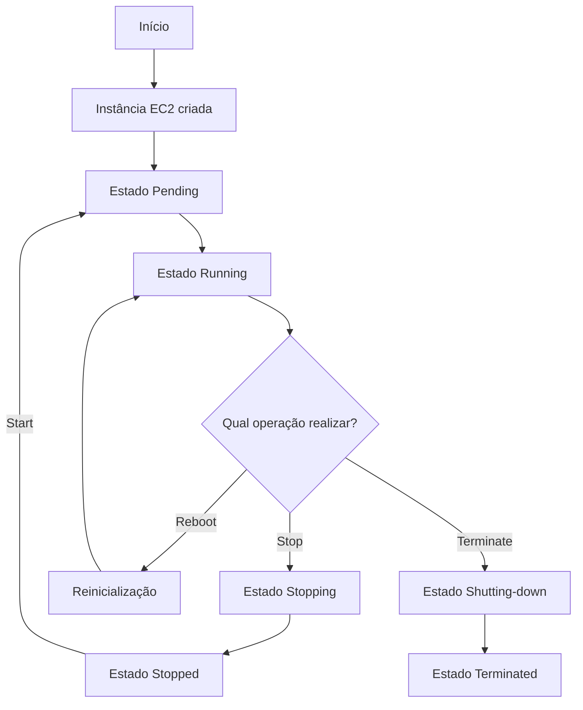

# Fluxo de Gerenciamento de Instâncias EC2

## 1. Objetivo

Representar visualmente as principais operações realizadas durante o gerenciamento de uma instância Amazon EC2.

## 2. Diagrama de fluxo

O diagrama abaixo representa um cenário simplificado de gerenciamento de uma instância.

## 3. Explicação do fluxo

- Pending: a instância está sendo iniciada.
- Running: a instância está em execução.
- Stopping: a instância está sendo parada.
- Stopped: a instância está desligada.
- Reboot: a instância é reinicializada.
- Shutting-down: a instância está sendo encerrada.
- Terminated: a instância foi encerrada definitivamente.

## 4. Importância do gerenciamento

Compreender o ciclo de vida de uma instância EC2 permite administrar os recursos computacionais de maneira organizada, segura e eficiente.

## 5. Observação

Este diagrama representa uma simulação conceitual para fins educacionais. Nenhuma instância real foi criada ou modificada durante esta atividade.
